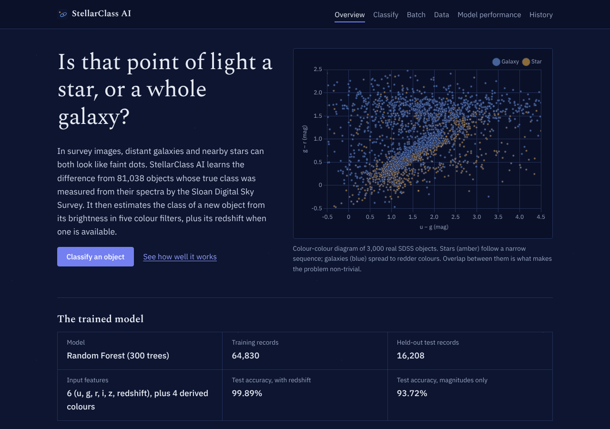

# StellarClass AI: star–galaxy separation with machine learning

StellarClass AI classifies astronomical objects as a **STAR** or a **GALAXY** from measurements made by the
Sloan Digital Sky Survey (SDSS). It covers the full machine-learning workflow on real survey data:

* data download with checksum verification
* cleaning
* exploratory analysis
* a tuned Random Forest compared against baselines
* honest evaluation on a held-out test set
* a Flask web app for interactive and batch predictions



---

## 1. What the project does

Given an object's apparent brightness (magnitude) in the five SDSS filters `u, g, r, i, z`, and optionally its
spectroscopic `redshift`, the trained model returns:

* the predicted class (STAR or GALAXY)
* the probability of each class
* a short plain-language explanation comparing the input with typical stars and galaxies

Two Random Forest models are trained:

| Model | Inputs | When the app uses it |
|---|---|---|
| **Magnitudes + redshift** (primary, course feature set) | `u, g, r, i, z, redshift` | A redshift is entered |
| **Magnitudes only** | `u, g, r, i, z` | The redshift field is left empty |

Both models also use four **colour indices** (`u−g, g−r, r−i, i−z`), which are computed automatically inside the
model pipeline.

## 2. Scientific motivation

Modern imaging surveys detect hundreds of millions of sources. In an image, a distant galaxy and a nearby star
can both look like a faint point of light. Separating them matters:

* galaxy surveys need clean galaxy samples to map large-scale structure
* studies of our own Milky Way need clean star samples

Taking a spectrum of every object is far too expensive, so astronomers classify most objects from photometry.
This project shows how well a machine-learning model does at that, using objects whose true class *is* known
from SDSS spectroscopy as training labels.

## 3. Dataset

* **Name:** *Stellar Classification Dataset – SDSS17* (fedesoriano, Kaggle, January 2022)
* **Origin:** SDSS **Data Release 17**, 100,000 spectroscopically classified objects (galaxies, stars, quasars)
* **Kaggle:** https://www.kaggle.com/datasets/fedesoriano/stellar-classification-dataset-sdss17
* **Automatic download:** a public GitHub mirror pinned to one commit, verified by SHA-256

`data/README.md` documents the source, checksum, cleaning steps, and an authenticity check: the SDSS
identifiers in the file decode to the file's own plate, fibre, MJD and run numbers.

**Citation:** Abdurro'uf et al. (2022), *The Seventeenth Data Release of the Sloan Digital Sky Surveys*,
ApJS 259, 35, doi:10.3847/1538-4365/ac4414. Funding for SDSS has been provided by the Alfred P. Sloan Foundation,
the U.S. Department of Energy Office of Science, and the Participating Institutions.

**Cleaning summary:**

| Step | Rows |
|---|---|
| Raw file | 100,000 |
| QSO (quasar) rows removed, leaving a binary task | 18,961 removed |
| Sentinel `-9999` magnitudes removed | 1 removed |
| Missing values / duplicates | 0 found |
| **Clean dataset** | **81,038** (59,445 galaxies, 21,593 stars, 26.6% stars) |

## 4. Features

| Feature | Meaning | Used? |
|---|---|---|
| `u` | Apparent magnitude, ultraviolet filter (~355 nm). Larger values mean a fainter object | Yes |
| `g` | Apparent magnitude, green filter (~469 nm) | Yes |
| `r` | Apparent magnitude, red filter (~617 nm) | Yes |
| `i` | Apparent magnitude, near-infrared filter (~748 nm) | Yes |
| `z` | Apparent magnitude, infrared filter (~893 nm) | Yes |
| `redshift` | Spectroscopic redshift: how far the spectrum is shifted towards red | Primary model only |
| `u_g, g_r, r_i, i_z` | Colour indices (differences of magnitudes), derived in the pipeline | Yes |
| `class` | Spectroscopic class: **target** | Label |
| `obj_ID, spec_obj_ID, run_ID, rerun_ID, cam_col, field_ID` | Identifiers | **No**: identifiers carry no physical information |
| `alpha, delta` | Sky position | **No**: describes where the object is, not what it is |
| `plate, MJD, fiber_ID` | Spectroscopic plate, date, fibre | **No**: can leak the label, since some plates were star-only programmes |

The dataset does **not** contain `psfMag_r`, `modelMag_r` or `petroRad_r`, so those features are not used.
They are morphology measures and would be valuable additions (see Future improvements).

**About redshift.** Stars in this sample all have |z| < 0.005, while galaxies are mostly at z ≈ 0.1–0.7. Redshift
therefore separates the classes almost perfectly. However, a redshift is measured *from a spectrum*, and once
SDSS has a spectrum its pipeline already assigns the class. A redshift-based classifier is useful for teaching
and for checking consistency. The **magnitudes-only** model reflects the realistic use case: objects that have
only been imaged.

## 5. Installation (Windows)

You need **Python 3.10 or newer** (tested with 3.13). Open **PowerShell** in the project folder.

Create a virtual environment:

```powershell
python -m venv .venv
```

Activate it:

```powershell
.\.venv\Scripts\Activate.ps1
```

If PowerShell refuses to run the script, allow local scripts for your user once, then activate again:

```powershell
Set-ExecutionPolicy -Scope CurrentUser -ExecutionPolicy RemoteSigned
```

Command Prompt users activate with `.venv\Scripts\activate.bat` instead.

Install the dependencies:

```powershell
pip install -r requirements.txt
```

On macOS/Linux, activate with `source .venv/bin/activate`; every other command is the same.

## 6. Prepare the dataset

```powershell
python -m src.data_loader
```

This downloads `star_classification.csv` (16.7 MB) to `data/raw/` and verifies its SHA-256 checksum. If the
download is blocked, follow the manual steps it prints (they are also listed in `data/README.md`).

## 7. Train the models

```powershell
python -m src.train
```

This step:

* cleans the data and writes `data/processed/sdss_star_galaxy.csv` and `reports/preprocessing_report.json`
* for each feature set, trains a majority-class baseline, Logistic Regression and a tuned Random Forest
  (randomized search, 12 configurations × 5-fold CV)
* saves the fitted pipelines to `models/stellarclass_rf_full.joblib` and `models/stellarclass_rf_photometric.joblib`
* writes every metric to `reports/metrics.json` and the figures to `reports/figures/`

The full run took about 22 minutes on a 4-core machine (the magnitudes-only search is the slow part). The saved
magnitudes-only model is about 29 MB because its trees are deep. To check that everything works, run
`python -m src.train --quick` (about 1 minute; it uses a smaller search, so its scores are slightly lower).

## 8. Evaluate the models

```powershell
python -m src.evaluate
```

This reloads the saved models, re-creates the same held-out test split (same seed and stratification), prints the
classification reports and redraws the confusion matrices. To classify one object from the command line:

```powershell
python -m src.predict --u 19.12 --g 17.74 --r 17.18 --i 16.98 --z 16.90 --redshift -0.00014
```

Leave out `--redshift` to use the magnitudes-only model.

The exploratory analysis is in `notebooks/exploratory_analysis.ipynb`, saved with its outputs. Open it with
`jupyter notebook notebooks/exploratory_analysis.ipynb`.

## 9. Run the web application

```powershell
python app.py
```

Then open http://127.0.0.1:5000 in a browser. Train the models first; otherwise the pages explain what to run.

| Page | What it shows |
|---|---|
| **Overview** | Project summary, a colour–colour diagram of real SDSS objects, and the trained model's real test results |
| **Classify** | Form for one object: prediction, probabilities, explanation; saved to History |
| **Batch** | Upload a CSV (up to 5,000 rows) and download it with predictions added |
| **Data** | Class balance, interactive histogram and scatter plots from a sample, feature descriptions, sample rows |
| **Model performance** | Metrics, confusion matrix, ROC curve, baseline comparison, feature importance, cross-validation, hyper-parameters |
| **History** | The last 50 predictions (SQLite, `instance/history.db`), with a Clear history button |

There is also a JSON API for use from other tools:

```bash
curl -X POST http://127.0.0.1:5000/api/predict -H "Content-Type: application/json" -d '{"u": 19.12, "g": 17.74, "r": 17.18, "i": 16.98, "z": 16.90, "redshift": -0.00014}'
```

Other endpoints are `GET /api/health`, `GET /api/metrics` and `GET /api/sample?n=500`.

## 10. Using the prediction interface

1. Open **Classify**.
2. Enter the five magnitudes, each between 0 and 40. Choose **Fill example star** or **Fill example galaxy** to
   load a real object from the dataset.
3. Optionally enter a redshift between −0.05 and 10. Leave it empty if unknown.
4. Choose **Classify**. Invalid or missing values are reported next to the field.
5. Read the result:
   * the class
   * the probability bar
   * evidence comparing the object's redshift and colours with typical stars and galaxies
   * a warning if any input lies outside the range seen in training

Predictions are statistical estimates, not definitive astronomical identifications.

## 11. Results

All numbers are on the **held-out test set of 16,208 objects** (4,319 stars, 11,889 galaxies), which was never
used for training or tuning. **STAR is the positive class.** These values are copied from `reports/metrics.json`
(seed 42).

### Magnitudes + redshift (`u, g, r, i, z, redshift`)

| Model | Accuracy | Bal. acc. | Precision | Recall | F1 | ROC-AUC |
|---|---:|---:|---:|---:|---:|---:|
| Majority-class baseline | 0.7335 | 0.5000 | 0.0000 | 0.0000 | 0.0000 | 0.5000 |
| Logistic Regression | 0.9894 | 0.9928 | 0.9617 | 1.0000 | 0.9805 | 0.9960 |
| **Random Forest** | **0.9989** | **0.9992** | **0.9961** | **0.9998** | **0.9979** | **0.9998** |

* Random Forest confusion matrix: 11,872 galaxies correct, 17 galaxies called stars, 1 star called a galaxy, 4,318 stars correct.
* 5-fold CV on the training set: F1 0.9977 ± 0.0005, ROC-AUC 0.9996 ± 0.0001.
* Tuned hyper-parameters: `n_estimators=300`, `min_samples_split=5`, `min_samples_leaf=2`, `max_features=None`, `max_depth=30`, `class_weight=balanced`.
* Most important (impurity): `redshift` (0.997), `u_g` (0.000), `i_z` (0.000). Largest permutation drops in ROC-AUC: `redshift` (0.495), `z` (0.000), `g` (0.000).

### Magnitudes only (`u, g, r, i, z`)

| Model | Accuracy | Bal. acc. | Precision | Recall | F1 | ROC-AUC |
|---|---:|---:|---:|---:|---:|---:|
| Majority-class baseline | 0.7335 | 0.5000 | 0.0000 | 0.0000 | 0.0000 | 0.5000 |
| Logistic Regression | 0.8186 | 0.7089 | 0.7540 | 0.4740 | 0.5820 | 0.8038 |
| **Random Forest** | **0.9372** | **0.9091** | **0.9092** | **0.8490** | **0.8781** | **0.9738** |

* Random Forest confusion matrix: 11,523 galaxies correct, 366 galaxies called stars, 652 stars called galaxies, 3,667 stars correct.
* 5-fold CV on the training set: F1 0.8827 ± 0.0039, ROC-AUC 0.9754 ± 0.0014.
* Tuned hyper-parameters: `n_estimators=300`, `min_samples_split=2`, `min_samples_leaf=2`, `max_features=log2`, `max_depth=30`, `class_weight=None`.
* Most important (impurity): `r_i` (0.329), `i_z` (0.186), `g_r` (0.132). Largest permutation drops in ROC-AUC: `r` (0.381), `i` (0.354), `z` (0.274).

**Interpretation.**

* **With redshift, the problem is almost solved by one feature.** Redshift accounts for 99.7% of the forest's
  impurity importance. Shuffling it costs about 0.5 of ROC-AUC (from about 1.0 to about 0.5, i.e. guessing),
  while shuffling any magnitude costs nothing measurable. Even Logistic Regression reaches 98.9% accuracy.
  Only 18 of 16,208 test objects are misclassified.
* **With magnitudes only, the Random Forest clearly earns its place.**
  * F1 for stars rises from 0.582 (Logistic Regression) to 0.878.
  * ROC-AUC rises from 0.804 to 0.974.
  * The forest still misses about 15% of stars (recall 0.849), and about 9% of the objects it calls stars are
    galaxies (precision 0.909).
* **Colours carry the photometric signal.** The redder colours `r − i`, `i − z` and `g − r` dominate impurity
  importance.
* **Cross-validation agrees with the test set.** Test scores fall within about one CV standard deviation of the
  CV means, so there is no sign of overfitting to the tuning folds.
* **Accuracy alone would mislead.** The "always galaxy" baseline already scores 73.4% accuracy while finding zero
  stars.

## 12. Testing

```powershell
python -m pytest
```

The tests use a small fixture of real SDSS rows (`tests/fixtures/`) and train quick models in a temporary folder,
so they need no internet access and take about 15 seconds. They cover:

* data loading
* checksum verification and missing-file errors
* cleaning
* label mapping
* the pipeline
* input validation
* missing or corrupt model files
* prediction structure and probabilities
* predictions on unseen records
* every Flask route
* CSRF protection
* history
* batch upload

## 13. Project structure

```
stellarclass-ai/
├── app.py                     Flask application (pages + JSON API)
├── config.py                  Paths, dataset info, feature sets, constants
├── requirements.txt
├── data/README.md             Dataset source, checksum, cleaning steps, citation
├── notebooks/exploratory_analysis.ipynb
├── src/
│   ├── data_loader.py         Download + checksum, loading, actionable errors
│   ├── preprocessing.py       Cleaning, label encoding, colour features, pipelines
│   ├── train.py               Baselines, Random Forest tuning, CV, saving
│   ├── evaluate.py            Metrics, figures, re-evaluation CLI
│   ├── predict.py             Model loading, input validation, prediction, explanations
│   └── history.py             SQLite prediction history
├── models/                    Saved pipelines (generated, not committed)
├── reports/                   metrics.json, preprocessing_report.json, figures/
├── templates/                 Jinja2 HTML templates
├── static/                    CSS, JavaScript, Chart.js (vendored), images
└── tests/                     pytest suite + real-data fixture
```

## 14. Limitations

* **Redshift makes the primary task easy.** The near-perfect scores of the redshift model mostly reflect that
  stars have z ≈ 0. Redshift needs a spectrum, which in practice already gives the class. Judge the project on
  the magnitudes-only results.
* **Selection bias.** Objects were chosen for SDSS spectroscopy by specific targeting programmes. The brightness
  and colour distributions differ from those of *all* objects in SDSS images, so performance on a random
  photometric catalogue may be lower.
* **Quasars excluded.** QSOs were removed for the binary task. A quasar given to the app will be forced into
  STAR or GALAXY. Point-like quasars are often confused with stars.
* **No morphology features.** The dataset lacks PSF-vs-model magnitude differences and sizes (e.g.
  `psfMag_r − modelMag_r`, `petroRad_r`). Those are the classic star–galaxy separators and would likely improve
  the photometric model.
* **Probabilities are vote fractions.** A Random Forest's probability is the share of trees voting for a class.
  It has not been calibrated, so "90%" does not guarantee that 90% of such objects are stars.
* **Feature importance is not causation.** It shows what the model relied on in this sample, and impurity
  importance splits credit between correlated features.
* **Magnitude errors are ignored.** The dataset has no measurement uncertainties.

## 15. Future improvements

* Query SDSS SkyServer/CasJobs directly for morphology features (`psfMag`, `modelMag`, `petroRad`) and
  measurement errors.
* Calibrate probabilities (`CalibratedClassifierCV`) and plot a reliability diagram.
* Tune the decision threshold for a chosen purity/completeness trade-off.
* Add a third class (QSO) as an optional multi-class model.
* Add optional SHAP explanations for individual predictions.
* Compare gradient-boosted trees (`HistGradientBoostingClassifier`).
* Deploy to a free host (for example PythonAnywhere or Render, subject to their current limits), with models
  trained at build time.

## 16. ML concepts for the viva

**Binary classification.** The model learns a function from features (magnitudes, colours, redshift) to one of
two labels. STAR is encoded as 1 (the positive class) and GALAXY as 0.

**Train/test split, stratified.** 80% of the rows train the model and 20% are held back until the very end.
*Stratified* means both parts keep the same 26.6% / 73.4% class ratio. The test set estimates performance on
new data. It is used once, after all tuning is finished.

**Data leakage.** This means information about the answer sneaking into the inputs. We avoid it in two ways:

* We drop identifiers and plate/fibre/date columns.
* All fitted preprocessing (such as `StandardScaler`) lives inside a scikit-learn `Pipeline`, so it learns only
  from the training folds.

**Feature engineering.** Colour indices such as `g − r` measure the *shape* of an object's spectrum and do not
depend on its distance. They are computed by a `FunctionTransformer` inside the pipeline, so the web app applies
exactly the same transformation.

**Decision tree.** A tree asks a sequence of yes/no questions (e.g. "is redshift < 0.003?"). Each split is chosen
to make the resulting groups as pure as possible, which means minimising Gini impurity.

**Random Forest.** Many decision trees, each trained on a bootstrap sample (random rows with replacement) and
considering a random subset of features at each split. The forest predicts by majority vote, and the share of
votes is the "probability". Averaging many de-correlated trees reduces overfitting compared with a single tree.

**Baselines.** A majority-class "always galaxy" model gets about 73% accuracy with zero stars found. That is why
accuracy alone is misleading. Logistic Regression is a simple linear model. On magnitudes alone it is far worse
than the forest, which suggests the class boundary is non-linear.

**Hyper-parameter tuning.** `RandomizedSearchCV` tries 12 random combinations of settings such as number of
trees, maximum depth, minimum samples per leaf, features per split and class weighting. It scores each
combination by **5-fold stratified cross-validation** on the training set only, then keeps the one with the best
F1.

**Cross-validation.** The training data is split into 5 folds. The model is trained on 4 and scored on the 5th,
rotating 5 times. The mean shows the expected performance; the standard deviation shows how stable it is.

**Metrics** (STAR = positive):

* *Precision*: of the objects predicted STAR, the fraction that really are stars (purity).
* *Recall*: of the real stars, the fraction found (completeness).
* *F1*: the harmonic mean of precision and recall.
* *Balanced accuracy*: the average of the recall for each class.
* *ROC-AUC*: the probability that a random star gets a higher star score than a random galaxy (1.0 = perfect,
  0.5 = random).
* *Confusion matrix*: counts of true/false positives and negatives.

**Feature importance:**

* *Impurity importance* is how much each feature reduced Gini impurity across all splits.
* *Permutation importance* is how much test ROC-AUC drops when one input column is shuffled.

Both describe the model's behaviour, not physical cause and effect.

**Model persistence.** The whole fitted pipeline (preprocessing + forest) is saved with `joblib`. The web app
loads it once and reuses it, so it never retrains per request.
